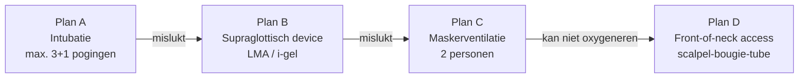

Oxygenatie gaat altijd vóór intubatie. Werk van eenvoudig naar complex, en heb **altijd een plan B, C en D** voordat je begint.

<small>Vrij naar de richtlijn van de Difficult Airway Society (DAS). Volg het lokale algoritme.</small>

## Voorspellers van een moeilijke luchtweg

| Moeilijk... | Let op |
|---|---|
| **Maskerventilatie** | Baard, obesitas, leeftijd > 55, geen tanden, snurken/OSAS, stijve longen |
| **Laryngoscopie** | Beperkte mondopening (< 3 vingers), Mallampati III–IV, korte thyromentale afstand (< 6 cm), beperkte nekbeweging, overbeet |
| **Supraglottisch device** | Beperkte mondopening, afwijkingen in de keel, hoge beademingsdrukken |
| **Front-of-neck access** | Obesitas, bestraalde of geopereerde hals, struma |

## Hulpmiddelen in dit onderdeel
De pagina's hieronder staan ongeveer op volgorde van invasiviteit.
