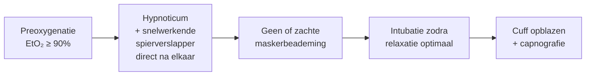

## Wanneer?

Een **Rapid Sequence Induction (RSI)** gebruik je als de patiënt een verhoogd risico heeft op **aspiratie** van maaginhoud, bijvoorbeeld:

- Niet nuchter (spoedoperatie, trauma)
- Ileus of darmobstructie
- Zwangerschap (vanaf het 2e trimester)
- Ernstige reflux, vertraagde maaglediging (bijv. diabetes, GLP-1-agonisten)

## Het verschil met een gewone inductie



| | Standaardinductie | RSI |
|---|---|---|
| **Volgorde** | Opioïd → hypnoticum → maskercheck → spierverslapper | Hypnoticum en spierverslapper direct na elkaar |
| **Spierverslapper** | [[Rocuronium]] 0,6 mg/kg | Rocuronium 1,0–1,2 mg/kg of succinylcholine 1–1,5 mg/kg |
| **Maskerbeademing** | Ja, voor relaxatie | Nee, of zacht (< 20 cmH₂O) bij desaturatie |
| **Cricoïddruk** | Nee | Afhankelijk van lokaal protocol (omstreden) |

> [!warning] Extra voorbereiding
> - Zuigunit **aan** en binnen handbereik
> - Patiënt in licht anti-Trendelenburg (hoofd omhoog)
> - Maagsonde overwegen om de maag vooraf te ontlasten
> - Plan B (larynxmasker, videolaryngoscoop) klaar

## Snel herhalen

```quiz
Vraag: Waarom gebruik je bij een RSI een hogere dosis rocuronium (1,0–1,2 mg/kg)?
- [ ] Omdat het blok dan korter duurt
- [x] Omdat de intubatiecondities sneller optimaal zijn (ca. 60 seconden)
- [ ] Omdat sugammadex dan niet meer werkt
Uitleg: Een hogere dosis verkort de inwerktijd. De keerzijde: het blok duurt langer – zorg dat sugammadex beschikbaar is.
```
