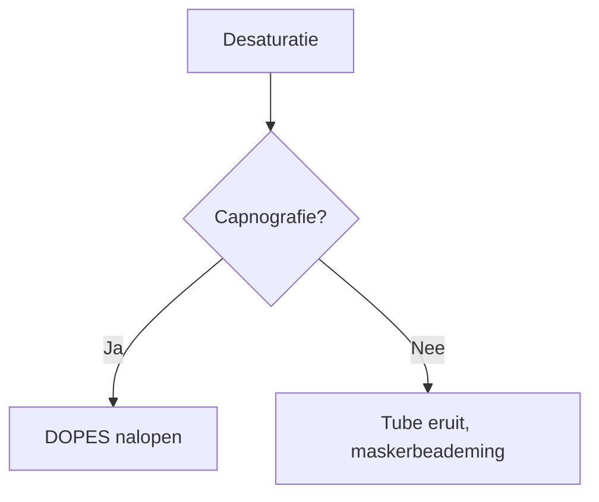

# Handleiding: AnesthesioLogisch beheren met Obsidian

Welkom! Deze map (de **kluis** of *vault*) ís de website. Alles wat je hier schrijft, verschijnt automatisch op AnesthesioLogisch. Je hebt geen ICT-kennis nodig.

> [!info] Deze map (`_beheer`) en `_sjablonen` komen níet op de website
> Mappen waarvan de naam begint met een liggend streepje `_` zijn alleen voor jou.

## 1. Hoe werkt het?

1. Je schrijft of wijzigt een notitie in Obsidian.
2. Je klikt op **Sync / Commit-and-sync** (de Git-knop links in Obsidian).
3. Binnen ca. 2 minuten staat de wijziging online.

Dat is alles. 🎉

## 2. Een nieuwe pagina maken

1. Klik met de rechtermuisknop op de map waar de pagina in hoort (bijv. *Farmacologie/Opioïden*) → **Nieuwe notitie**.
2. Geef de notitie een duidelijke naam, bijv. `Ketamine`. Die naam wordt de titel op de website.
3. Kies via `Ctrl/Cmd + P` → *Sjabloon invoegen* het sjabloon **Nieuwe pagina**, **Nieuw medicijn** of **Nieuwe vaardigheid**.
4. Vul de tekst in.

**Een nieuw onderwerp (map)?** Maak een nieuwe map, en daarin een notitie met *precies dezelfde naam* als de map (bijv. `Luchtweg/Luchtweg.md`). Die notitie wordt de overzichtspagina van dat onderwerp, en het onderwerp verschijnt vanzelf als kaart op de startpagina.

## 3. Eigenschappen bovenaan een pagina

Bovenaan elke notitie staan **eigenschappen** (in Obsidian: *Properties*). Ze zijn allemaal optioneel:

| Eigenschap | Wat doet het? | Voorbeeld |
|---|---|---|
| `titel` | Titel op de website (anders de bestandsnaam) | `Propofol` |
| `beschrijving` | Korte samenvatting onder de titel, in zoekresultaten en kaarten | `Snel werkend inductiemiddel` |
| `tags` | Labels om pagina's te groeperen | `[inductie, hypnoticum]` |
| `aliases` | Andere namen waarmee je ernaar kunt linken én zoeken | `[Diprivan]` |
| `volgorde` | Positie in het menu (laag = bovenaan) | `1` |
| `icoon` | Emoji bij een onderwerp (mapnotitie) | `💊` |
| `auteur` | Naam van de schrijver | `Dr. Jansen` |
| `concept` | `true` = nog níet publiceren | `true` |

## 4. Opmaak – spiekbriefje

| Wat wil je? | Typ dit |
|---|---|
| **Vet** | `**vet**` |
| *Schuin* | `*schuin*` |
| ==Markeren== | `==markeren==` |
| Kopje | `## Kopje` (of `### Subkopje`) |
| Opsomming | `- punt` |
| Genummerde lijst | `1. stap` |
| Link naar andere pagina | `[[Propofol]]` |
| Link met andere tekst | `[[Propofol\|dit middel]]` |
| Link naar een kopje | `[[Propofol#Effecten]]` |
| Afbeelding | Sleep een afbeelding in de notitie → `![[foto.png]]` |
| Afbeelding kleiner | `![[foto.png\|300]]` |
| Tag | `#inductie` |
| Tabel | Gebruik in Obsidian: rechtermuisknop → *Tabel invoegen* |

### Kaders (callouts)

```
> [!tip] Titel van het kader
> Tekst in het kader.
```

Beschikbare soorten: `tip`, `info`, `warning` (let op), `danger` (gevaar), `dosering`, `klinisch` (in de praktijk), `abstract` (samenvatting), `example` (voorbeeld), `question` (vraag), `quote` (citaat).

**Inklapbaar kader** (handig voor antwoorden!): zet een `-` achter de soort:

```
> [!question]- Wat is de MAC van sevofluraan?
> Ongeveer 2%.
```

### Quizvraag

````
```quiz
Vraag: Wat is de inductiedosis propofol?
- [ ] 0,5 mg/kg
- [x] 1,5–2,5 mg/kg
- [ ] 5 mg/kg
Uitleg: Bij ouderen lager doseren.
```
````

- Het goede antwoord krijgt een `x`: `- [x]`. Meerdere goede antwoorden mag.
- Meerdere vragen? Begin gewoon opnieuw met `Vraag:` in hetzelfde blok.

### Interactieve animatie invoegen

````
```animatie
monitor
```
````

Beschikbare animaties:

| Naam | Wat is het? | Extra instelling (optioneel) |
|---|---|---|
| `monitor` | OK-monitor met scenario's | `scenario: hypoxie` (of `tachycardie`, `bradycardie`, `hypotensie`, `bronchospasme`, `oesofageaal`, `mh`, `vf`) |
| `hart` | Bloedstroom door het hart | – |
| `inductie` | Stap voor stap in slaap brengen | – |
| `capnografie` | Capnogram-patronen | `patroon: obstructie` |
| `zuurstofcurve` | Zuurstofdissociatiecurve | – |

Voorbeeld mét instelling:

````
```animatie
monitor
scenario: bronchospasme
```
````

In Obsidian zie je alleen het blok met tekst; op de website wordt het de echte animatie.

### Stroomschema

````

````

## 5. Afbeeldingen en bestanden

Sleep een afbeelding of PDF in je notitie. Obsidian zet het bestand automatisch in de map `_bijlagen`. Op de website verschijnt het vanzelf.

> [!warning] Privacy
> Gebruik **nooit** patiëntgegevens of herkenbare foto's van patiënten. Gebruik alleen afbeeldingen waarvan je de rechten hebt.

## 6. Hulp nodig?

- Zie je na een paar minuten je wijziging niet online? Kijk op GitHub bij *Actions*: een rood kruisje betekent dat er iets misging. Meestal is het een tikfout in de eigenschappen bovenaan een pagina.
- Een link die grijs en gestreept is op de website, verwijst naar een pagina die (nog) niet bestaat. Handig als to-do-lijstje!
